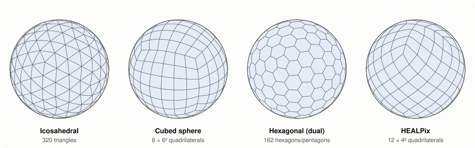
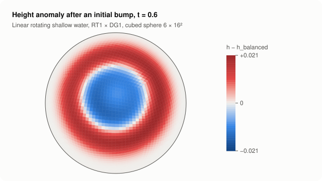
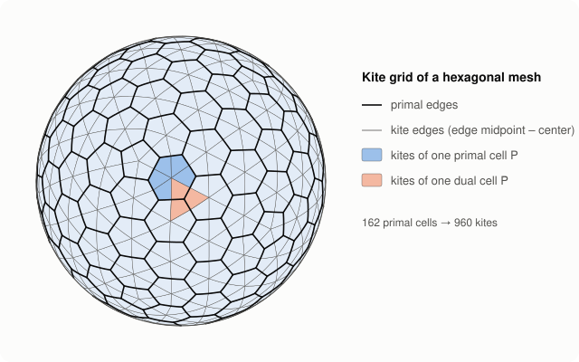
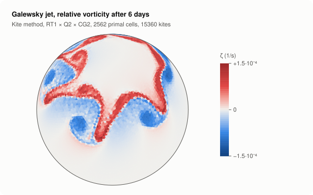
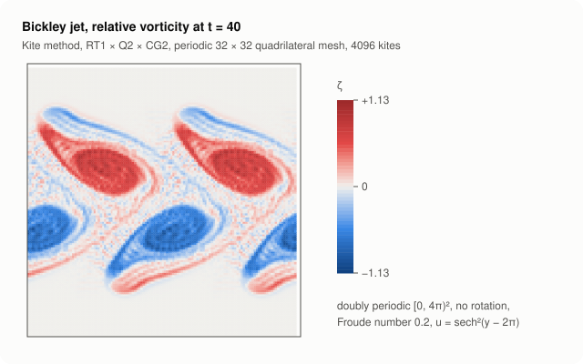

# dmplex.jl

`dmplex.jl` is a Julia-native mesh and finite-element library for the sphere,
modelled on PETSc's `DMPlex`, `PetscSection` and `PetscFE` but implemented
directly in Julia, without calling PETSc. It is built for compatible
(mimetic) finite-element models of the atmosphere, in the spirit of
Cotter & Shipton (2012), Gusto/Firedrake and the FEM part of
[CGDycore.jl](https://github.com/CliMA/CGDycore.jl/tree/main/src/FEM).



**What it does today**

- **Meshes as a DAG.** Every mesh (generated, or read from an ICON or MPAS
  grid file) is a `Plex`: cells, edges and vertices with PETSc-style cone
  orientations, stored in compressed arrays. The same code runs on
  triangles, quadrilaterals and polygons.
- **Finite elements of any order** on triangles and quadrilaterals:
  Lagrange, discontinuous, Raviart–Thomas and Nédélec, mapped exactly onto
  the sphere with the Piola transforms. Global numbering comes from a
  `Section` alone; the tests check H1, H(div) and H(curl) conformity across
  every edge to machine precision.
- **Shallow-water models.** Linear (RT_k × DG_k) and nonlinear
  vector-invariant (RT_k × DG_k × CG_{k+1}) rotating shallow water. Both
  conserve mass and energy in the semi-discretization; mass matrices are
  factorized once and shared between models.



```julia
using dmplex

dm = create_cubed_sphere_mesh(16)               # or read_grid("icon_grid_….nc")
model = NonlinearShallowWater(dm, 1)            # RT1 × DG1 × CG2
y = initial_state(model, velocity, height)      # L2 projections of initial fields
rk4_step!(y, dt, tendency!, RK4Cache(y), model)
```

The figures are generated with `julia --project docs/make_figures.jl`.

## Layout

| Directory | Module | Contents |
|---|---|---|
| `src/Topology` | `Topology` | `Plex` (mesh DAG in CSR form with PETSc orientations), `Section` (dof layout), `closure_dofs` |
| `src/Grids` | `Grids` | icosahedral, cubed-sphere, hexagonal, HEALPix and periodic plane meshes; ICON and MPAS grid-file readers (primal or dual); kite grids |
| `src/Geometry` | `Geometry` | reference triangle/quadrilateral, reference-to-sphere map, Piola maps, FV metrics |
| `src/FEM` | `FEM` | quadrature, element families of arbitrary order, `ReferenceElement`, `FESpace`, assembly (mass, divergence, Coriolis, load, projection), cached `mass_solver` |
| `src/FiniteVolumes` | `FiniteVolumes` | first-order upwind advection; C-grid shallow water with TRiSK operators on Voronoi meshes (`TRiSKShallowWater`, as in MPAS and the hexagonal ICON; PV flux of TRiSK or Gassmann); the triangular C grid of ICON with RBF tangential velocity (`ICONShallowWater`) |
| `src/TimeSteppers` | `TimeSteppers` | explicit Euler, classical RK4 |
| `src/ShallowWater` | `ShallowWater` | linear and nonlinear rotating shallow water: mixed RT_k × DG_k (× CG_{k+1}) and the staggered kite method, mass and energy conserving |
| `src/Parallel` | `Parallel` | equal-area partition, MPI distribution of kite models and of classical spaces, halo exchange |
| `src/Outputs` | `Outputs` | VTKHDF output for ParaView; ADIOS2/VTX output from host or GPU arrays (`using ADIOS2`) |
| `ext` | | package extensions: ADIOS2 output, cuDSS mass solvers on one or many GPUs (`using CUDA, CUDSS`) |
| `docs` | | figure generation (`make_figures.jl`, plain SVG) |

## Grids

```julia
dm = create_healpix_mesh(16)                              # 12·16² quads
dm = create_spherical_mesh(6; spring_beta=1.2)            # icosahedral, spring dynamics (Tomita et al. 2002)
dm = create_hexagon_mesh(6; centroidal=true)              # its Voronoi dual as an SCVT (Lloyd), as MPAS
dm = read_grid("grid/icon_grid_0010_R02B04_G.nc")          # ICON triangles
dm = read_grid("grid/x1.40962.grid.nc"; dual=true)         # MPAS Delaunay triangles
```

ICON and MPAS files are read with NCDatasets; cells and vertices keep the
file numbering. Open (regional or ocean) meshes such as MPAS-Ocean QU240 are
supported. Finite elements need triangles or quadrilaterals, so Voronoi grids
(MPAS primal, ICON dual) are for finite volumes until the kite grid exists.
Local grid files live in `grid/`, which is not tracked.

## Mesh topology

Points are numbered as in an interpolated PETSc mesh: cells, edges, vertices.
Edges run from their lower to their higher vertex, cells are counter-clockwise
seen from outside. Each cone entry stores a PETSc orientation (`0` along the
edge, `-1` reversed), so the cell with orientation `0` is the *left* cell of
an edge, and the edge normal points from left to right.

## Finite elements

`Lagrange(k)`, `Discontinuous(k)`, `RaviartThomas(k)` and `Nedelec(k)` are
available for any order, on triangles (P_k, RT_k, N_k) and quadrilaterals
(Q_k, RTCF_k, NCE_k). A `ReferenceElement` is built numerically. Its prime
basis is a tensor-Legendre basis, its dof functionals are GLL-node values,
normal/tangential components at edge Gauss points and interior moments, and
the basis is the dual of the functionals. Dofs come in PETSc closure order.
Global numbering is done only by the `Section`. `closure_dofs` reverses edge
nodes and flips signs on reversed edges, which makes the spaces H1-, H(div)-
or H(curl)-conforming on the sphere. The reference cells are mapped to the
sphere by radial projection, which reproduces the great-circle edges exactly.

```julia
using dmplex

dm = create_cubed_sphere_mesh(8)        # or create_spherical_mesh(3) for triangles
V = FESpace(dm, RaviartThomas(2))       # element chosen per cell shape
M = assemble_mass(V)

# mixed RT_k × DG_k on one section, e.g. for shallow water
s = Section(dm, field(RaviartThomas(1); name="u"), field(Discontinuous(1); name="h"); ordering=:field)
U, H = FESpace(dm, s, "u"), FESpace(dm, s, "h")
```

## Kite grids



`create_kite_mesh(primal)` splits every cell of any polygonal mesh (generated,
ICON or MPAS) into quadrilaterals by joining its center with the edge
midpoints. The result is an ordinary quad `Plex` with a canonical local
numbering (vertex 1 the primal vertex, vertex 3 the center) and labels for the
parent primal cell, the dual cell (primal vertex) and the edge type. This is
the basis for the staggered kite discretization of the shallow-water
equations (Knoth, EGU 2026): height broken across primal edges with
Gauss–Radau nodes, velocity broken-RT on dual cells, vorticity continuous on
the kites, all with diagonal or block-diagonal mass matrices.

`NonlinearKiteShallowWater(primal, 1)` implements it with RT1 velocity, Q2
height and CG2 vorticity. By default the mass flux is projected into the
velocity space and the vorticity term uses the potential vorticity, which
conserves mass and energy exactly; the poster form is available with
`flux=:pointwise, vorticity=:absolute`. Metric terms are precomputed at one
3 × 3 quadrature rule per kite and a time step does not allocate.



The same model runs on doubly periodic planes (`create_periodic_plane`):



## Direction

The goal is finite-element modelling of the linear and nonlinear shallow-water
equations on the sphere with the kite-grid approach of
[CGDycore.jl](https://github.com/CliMA/CGDycore.jl/tree/main/src/FEM). This is
an independent implementation, not a wrapper around CGDycore or PETSc.

## Run

```sh
julia --project -e 'using Pkg; Pkg.test()'
julia --project examples/advection.jl 4 cubed            # FV upwind advection, writes VTKHDF
julia --project examples/linear_shallow_water.jl 2 cubed 8   # RT2 × DG2 linear shallow water
julia --project examples/nonlinear_shallow_water.jl 1 healpix 8   # Williamson TC2, also with an ICON/MPAS file
julia --project examples/trisk_shallow_water.jl hexagon 6         # TC2 with the TRiSK finite-volume scheme
mpiexec -n 4 julia --project examples/trisk_galewsky.jl hexagon 7 6 --gassmann-mean   # Galewsky, finite volumes
mpiexec -n 4 julia --project examples/trisk_galewsky.jl icon_grid_0021_R02B06_G.nc 0 6 --icon   # ICON triangles
mpiexec -n 4 julia --project examples/nonlinear_shallow_water.jl 1 cubed 16   # the same over MPI
mpiexec -n 4 julia --project=examples/gpu examples/nonlinear_shallow_water.jl 1 cubed 64 --gpu   # GPUs, cuDSS
julia --project docs/galewsky_figure.jl hexagon 4 6   # Galewsky jet with the kite model, 6 days
julia --project docs/bickley_figure.jl quadrilateral 32 40   # Bickley jet on a periodic plane
mpiexec -n 4 julia --project=examples/gpu examples/galewsky.jl hexagon 6 6 --gpu --adios   # GPUs, ADIOS2 output
```

GPU runs (kite model on CUDA, ADIOS2 output straight from the device, cuDSS
mass solvers over MPI) are described in [docs/levante.md](docs/levante.md).

## License

Copyright 2026 Oswald Knoth. Licensed under the [Apache License 2.0](LICENSE).

The equal-area partitioning follows the implementation in
[CGDycore.jl](https://github.com/CliMA/CGDycore.jl) (Apache License 2.0), which
in turn follows the zonal equal-area algorithm of Leopardi (2006) as used in
ECMWF's Atlas library.
