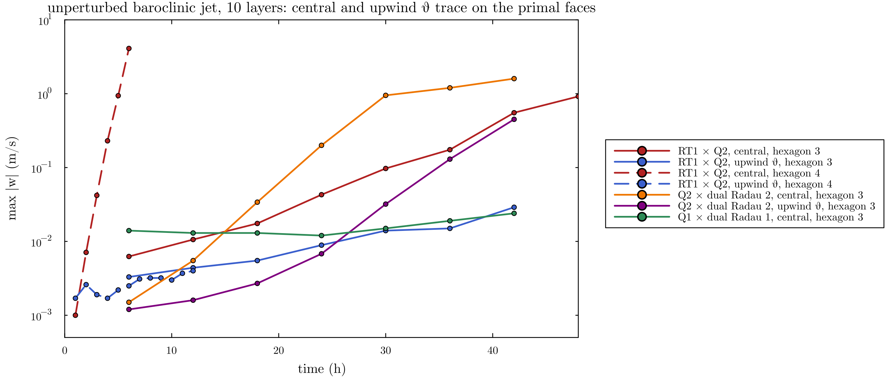
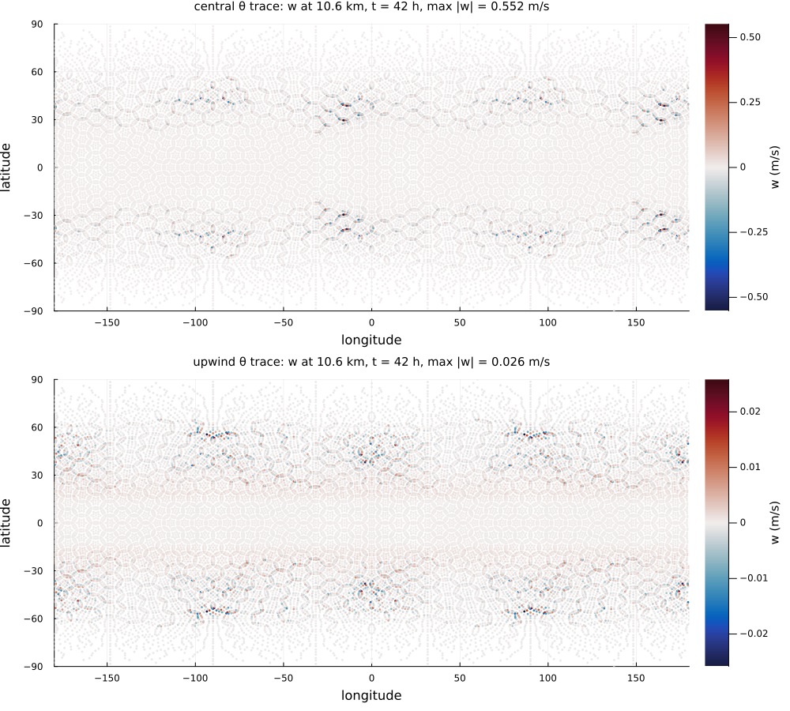
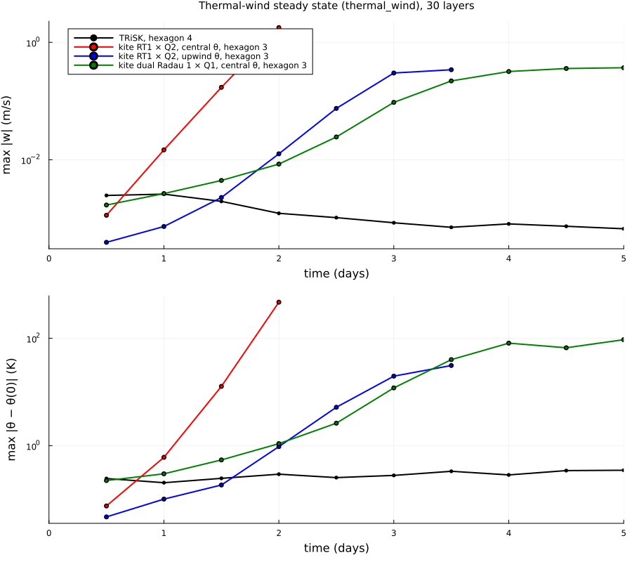

# Plan: 3D kite model as a direct product

The nonhydrostatic compressible Euler equations on the extruded kite mesh. The spaces are tensor
products of the 2D kite spaces of `NonlinearKiteShallowWater` with 1D spaces on the vertical
grid, in the split-order form of Witt, Bendall & Shipton (arXiv:2603.16571), with Lorenz staggering
as in ICON and `TRiSKNonhydrostatic`. The 3D dual-cell method of Codecasa, Kapidani, Schöberl &
Wess (arXiv:2604.13921, Maxwell on tetrahedra with barycentric duals) is not used: its dual cells
cut through the columns, so there is no column structure for a HEVI solver.

## Spaces

Horizontal factors (2D kite spaces, order k):
- H_h = `KiteRadau(k)`: Q_k on the kites with Gauss–Radau nodes, broken across primal edges.
  Diagonal mass matrix.
- U_h = `KiteBrokenRT(k)`: broken H(div) on the dual cells. Block-diagonal mass matrix, one block
  per dual cell.

Vertical factors (order v on the layers of `VerticalGrid`): DG_v per layer, CG_{v+1} continuous
across the interfaces.

| Field | Space | Lowest order (k = 1, v = 0) |
|---|---|---|
| ρ | H_h ⊗ DG_v | Q2 Radau × constant per layer |
| ρθ | H_h ⊗ DG_v (Lorenz: with ρ) | as ρ |
| w | H_h ⊗ CG_{v+1} | Q2 Radau × linear, values at the interfaces |
| u_h | U_h ⊗ DG_v | RT1 kite × constant per layer |

Together (u_h, w) ∈ V1 = (U_h ⊗ DG_v) ⊕ (H_h ⊗ CG_{v+1}) and ρ, ρθ ∈ V2 = H_h ⊗ DG_v: the
divergence maps V1 into V2, so the discrete continuity equation is exact per kite column.

**Lorenz staggering.** θ lives in the layers with ρ, and the pressure gradient at the w points
interpolates θ to the interfaces. This is the layout of ICON and of `TRiSKNonhydrostatic`, with its
computational mode in the vertical; the upwind θ at the interfaces of `theta_interface_kernel!`
(ICON-IAP `ltheta_up_vert`) carries over. Higher-order reconstruction of θ inside the DG_v layers is
possible later. That is the reason for Lorenz rather than Charney–Phillips (θ with w), which the
split-order paper uses.

## Mass matrices and columns

The Radau nodes of H_h are both the dofs and the quadrature points, so the horizontal mass
matrix of ρ, ρθ, w is diagonal. The vertical terms (∂_z of the mass and ρθ fluxes, the vertical
pressure gradient, buoyancy) involve no horizontal derivative, so they decouple into **independent
columns, one per horizontal Radau node**. For v = 0 a column is the same tridiagonal system in w,
after eliminating ρ and ρθ, as in `vertical_solve_kernel!`. For v > 0 it is a block-banded system
of width v + 1.

The horizontal momentum has the mass matrix (dual-cell block of U_h) ⊗ (layer block of DG_v), so
it can be inverted block-diagonally, which allows explicit horizontal terms.

## Time stepping (HEVI)

As in `TRiSKNonhydrostatic`: Wicker–Skamarock RK3. In each stage:
1. **Explicit horizontal terms**, per layer, with the 2D kite operators of
   `NonlinearKiteShallowWater` and ρ in place of h:
   - mass and ρθ fluxes in U_h;
   - vorticity in the continuous kite space and the PV term;
   - kinetic energy;
   - horizontal pressure gradient c_p θ ∇π, tested with U_h.
2. **Implicit vertical terms**, per Radau column: w, ρ, ρθ at t + τ, linearized around the Exner
   pressure of the base state. π0 and κπ0/ρθ0 are computed once per step.
3. **Vertical advection of u_h and w**, explicit, in the ICON-IAP mass-flux form.

## Steps

Done (`src/Nonhydrostatic/KiteNonhydrostatic.jl`, tests in `test/extruded.jl`): steps 1 and 2 at
lowest vertical order, serial. The state is `(u, w, ρ, ρθ)` as arrays (dofs × levels).

1. **Extruded kite spaces** (done: `zero_state`, `project_layers`, `project_velocity`,
   `mass_divergence!`; mass to round-off, column sums exact): dof numbering of H_h ⊗ DG_v, H_h ⊗ CG_{v+1} and U_h ⊗ DG_v on top of
   `create_kite_mesh` and `VerticalGrid`, with layer-innermost or point-innermost layouts for the
   GPU (blocks of points × levels, as `BLOCK` in `TRiSKNonhydrostatic`). Tests: dimensions, and the
   divergence V1 → V2 exact per column.
2. **Column solver for v = 0** (done: `column_points`, `initial_state` with `balanced_column`,
   `vertical_stage!`, `vertical_step!`; rest state w < 1e-12 with `:upwind` and `:centred`, column
   mass to round-off; `:iap` leaves rest as in `TRiSKNonhydrostatic`): reuse `vertical_solve_kernel!` and `theta_interface_kernel!` with
   one column per Radau node. Tests: hydrostatic rest state at rest, and a column at rest staying
   at rest with upwind θ.
3. **Horizontal terms per layer** (done without vertical advection: `horizontal_tendency!`, `stage!`,
   `step!`; F = Π_U(ρu), Fθ = Π_U(θF), pressure gradient −c_p Π_U(θ∇π) with ∇π = M_u⁻¹Bᵀπ/a, which
   makes the energy exchange exact (residual 1e-16 of the summed products); rest state at rest.
   The sub-cell instability of the rest state, see below, came from the quadrature of the velocity
   mass and is fixed) from the kite shallow-water operators. Tests: mass conservation
   to round-off, energy exchange between the horizontal and vertical terms.
4. **Test cases:**
   - inertia-gravity wave (Skamarock–Klemp on the plane with `create_periodic_plane`, the
     Baldauf–Brdar sphere version);
   - the baroclinic wave, compared with `TRiSKNonhydrostatic` on the same hexagon mesh.
5. **GPU** with KernelAbstractions, as the 2D kite model.
6. **Higher vertical order** (v = 1) and the θ reconstruction in the layers.

## Sub-cell instability on non-affine kites (2026-11-03, solved)

**Cause:** the velocity mass `M_U` was assembled with the default rule of the space (degree 6), the
projections `Π_U(h v)` with the 3×3 rule of `KiteQuadrature` (degree 4). On non-affine kites the
metric `JᵀJ/det J` is rational, so the two differ and `Π_U(c v) = c M_U⁻¹ R v ≠ c v` for a constant
`c` (1.4e-2 on hexagon 3, 1e-4 on the cubed sphere from the curvature). Then the ρθ flux
`Π_U(θ̄ F) = θ̄ P F` is not `θ̄` times the mass flux `F`: the horizontal fluxes create sub-cell `θ′`
(entropy) at rest. The energy stays conserved, but the Casimir `∫ ρ f(θ)` that makes the stratified
rest state stable does not, and the mode lives on the released potential energy. On affine kites
(cubed sphere) the integrand is a polynomial, both rules are exact and `P = I`.

**Fix:** `NonlinearKiteShallowWater(...; mass_degree)`, and `KiteNonhydrostatic` passes the degree
of the projections, so `Π_U(c v) = c v` to round-off (tested). The noise on the rest state now
decays on hexagons 3 and 4.

**Still open:** the unperturbed baroclinic wave on hexagon 3 grows from day 1 in the jet (33–39°,
levels 6–7; w 1.8 m/s and Δu 2 m/s at 48 h), while `TRiSKNonhydrostatic` (hexagon 4) stays bounded
for 48 h also without Smagorinsky diffusion (w ≈ 1e-2 m/s). Step 3b, the vertical coupling of the
vector-invariant form (`vertical_advection=:vector_invariant`, default: `-η w` in the `u` equation,
`η ⋅ ṽ - ∂K/∂z` in the `w` equation, exactly adjoint), slows it (w 0.9 m/s at 48 h) but does not
remove it.

The growing jet mode (2026-11-03, open), unperturbed baroclinic wave, dt 150 s, 10 layers:

- **Spatial:** the same growth at dt 50 and 150 s; faster on finer meshes (max|w| at 36 h:
  hexagon 2 0.03, hexagon 3 0.17, hexagon 4 5 m/s).
- **Pictures** (hexagon 3 and cubed sphere 10, 42 h): node-scale noise in w and θ′ (up to ±20 K in
  the upper levels) in the jet at 30–55°, also inside the primal cells; somewhat stronger next to
  primal edges that the flow crosses (40 % more w than next to edges along the flow); on the cubed
  sphere strongest at the cube corners and edges. Not specific to the icosahedral grid.
- **Pairs** (hexagon 3, max|w| at 42 h): RT1 × Q2 (default) 0.55 m/s, RT1 × Q1 1.7, RT1 × Q0
  0.6 (unbalanced from the start, bounded); Wess et al., Q2 × dual Radau 2: 1.6 m/s,
  **Q1 × dual Radau 1: 0.024 m/s, bounded** (TRiSK hexagon 4: 0.01). Velocity choice
  `KiteNonhydrostatic(...; velocity=:dual_radau)` with the exact velocity mass in the rule of the
  projections (`velocity_lumped=false`), so `Π_U(c v) = c v` also holds there.
- **Consistency at t = 0:** ρθ̇ converges at first order and is not concentrated at primal edges;
  the w tendency of the balanced state is 3e-14; u̇ converges in the lower layers, in the upper
  layers it is set by the vertical resolution (second order in Δz, from the discrete hydrostatic
  integration of the initial state, as for TRiSK).
- **Central θ trace on the primal faces:** B pairs the traces of the broken θ from both sides with
  the single-valued normal component of Π_U(θF), and the jump [θ] never enters. The upwind trace,
  see the next section, is the DG-type stabilization.

## Upwind θ trace on the primal faces (2026-11-04)

`KiteNonhydrostatic(...; horizontal_theta=:upwind)` adds the DG upwind correction
`-∫_e η_i |F⋅n|/2 (θ^K - θ^E)` on every primal face to the ρθ flux (`upwind_theta!`, see
[KITE3D_DISCRETIZATION.md](KITE3D_DISCRETIZATION.md)). It conserves ρθ, vanishes for constant θ and
dissipates the θ variance (tested). Serial CPU loop for now.

**Steady jet** (unperturbed baroclinic wave, 10 stretched layers), max |w|:

| pair, mesh | central | upwind θ |
|---|---|---|
| RT1 × Q2, hexagon 3, 42 h | 0.55 m/s, growing | **0.029 m/s** |
| RT1 × Q2, hexagon 4 (dt 60 s), 6 h / 12 h | 4.1 m/s at 6 h | **0.0025 / 0.004 m/s** |
| Q2 × dual Radau 2, hexagon 3, 42 h | 1.6 m/s | 0.45 m/s, still growing |
| Q1 × dual Radau 1, hexagon 3, 42 h | 0.024 m/s | – |
| Q1 × dual Radau 1, hexagon 4, 12 h | 0.012 m/s | 0.011 m/s |

The growth with resolution is gone for RT1 × Q2: on hexagon 4 the upwind run stays at the TRiSK
level. The node-scale pattern is 20 times weaker but still visible near the pentagons at 50–60°:

**Perturbed baroclinic wave**, 30 layers, hexagon 3 (8322 columns, dt 150 s), Q1 × dual Radau 1,
central θ: minimum p_s 989.2 (day 6), 985.1 (7), 981.4 (8), 978.2 (9), 976.6 hPa (day 10); mass to
2e-16. The wave develops but is far too weak (TRiSK hexagon 5: 921.8 hPa at day 10), as expected for
about 100 km columns of first order. The same pair on hexagon 4 grew from 0.03 to 0.25 m/s between
day 1 and 1.5 (w noise, before the wave), so it is not stable at higher resolution either; the run
was stopped. RT1 × Q2 with upwind θ on hexagon 3 is running.

**Thermal wind** (`thermal_wind`, new steady state in exact gradient-wind balance, 30 layers,
5 days, `examples/thermal_wind.jl`): this is the hardest test so far.

| model | max \|w\| day 1 | day 2 | day 3 | max \|θ′\| |
|---|---|---|---|---|
| TRiSK, hexagon 4 | 2.6e-3 | 1.2e-3 | 8.4e-4 | 0.35 K at day 5, steady |
| kite RT1 × Q2, central | 1.5e-2 | 1.8 | crashes (p < 0) | 470 K at day 2 |
| kite RT1 × Q2, upwind θ | 7.3e-4 | 1.3e-2 | 0.30 | 31 K at day 3.5 |
| kite dual Radau 1 × Q1, central | 2.7e-3 | 8.4e-3 | 9.5e-2 | 94 K at day 5 |

All kite variants grow, the upwind trace only delays it by about a day. θ′ is largest in the
tropics and subtropics (0–45°, where the wind is strongest), through the whole column (27 K at
15 km for dual Radau 1).

**One layer, θ = 1, p = g(ρθ)²/2** (`equation_of_state=:shallow_water`, the shallow-water test of
the compressible code, 2026-11-04): the horizontal tendencies of one layer agree with
`NonlinearKiteShallowWater` to round-off (u̇ 4e-14, ρ̇ exactly, ρθ̇ = ρ̇ to 3e-15; tested), so the
2D → 3D step of the horizontal terms is correct. But TC2 through the 3D step blows up within two
days, while the 2D model runs: θ − 1 grows from round-off by about 1e9 per day. The one-layer model is
thermal shallow water, and θ′ is unstable there, i.e. already horizontally, without any vertical
coupling:

| one layer, random θ′ = 1e-8 | max \|θ − 1\| after ¼ … 1 day |
|---|---|
| at rest, hexagon 3 | 5e-8, bounded |
| TC2, hexagon 2 | 1.3e-7 → 5e-5 (×7 per ¼ day) |
| TC2, hexagon 3 | 1.8e-6 → 3.5e-2 → NaN (×150 per ¼ day) |
| TC2, cubed sphere 8 | 1.8e-7 → 1.4e-5 (×4 per ¼ day) |

The growth needs the flow and scales like 0.3 |u|/Δx: an advective instability of θ′, the same
signature as the 3D jet mode. The conserved energy bounds u and ρθ but not ρ and θ separately. The
upwind θ trace (×1000 per day instead of 1e9) and the upwind traces of ρ and ρθ
(`horizontal_theta=:upwind_density`, same rate) slow it but do not remove it: most of the mode lies
inside the primal cells, where ρ and θ are continuous. The instantaneous Casimir rate
d/dt Σ M ρ(θ−1)² is zero for smooth θ′ and small for random θ′ (2e-3), so the mode is a coupled
u–ρ–θ′ mode through the pressure term −gρ∇θ′ − gθ′∇ρ, not passive advection.

**Open problems of the kite model:**

1. The node-scale mode is not removed by the upwind θ trace alone on a flow with strong
   cross-edge wind everywhere; it is already present in one layer (thermal shallow water, above),
   so it has to be fixed in the horizontal θ coupling. Candidates:
   - the pressure gradient `-c_p Π_U(θ∇π)` still uses the central θ, so the upwind ρθ flux has
     no adjoint in the momentum equation and the energy pair is no longer consistent;
   - ρ is also broken across the primal edges and only the mass flux is single valued;
   - θ in `Π_U(θ F)` is the Q2 interpolation of the nodal θ, with no limiting.
   Next: the upwind θ also in the face part of the pressure gradient (an energy-consistent
   upwind pair), then the same correction for ρ.
2. The upwind term is a CPU loop; GPU kernel and distribution still to do.
3. Coarse columns of first order give a far too weak baroclinic wave; resolution and order must
   go up together, which needs the GPU.

Record of the search:

The full step (horizontal explicit, columns implicit) is unstable on the hexagon and triangle meshes:
small noise on a stratified rest state grows by about ×6 every 2 h (hexagon 3, 10 layers), the
unperturbed baroclinic wave blows up within 16 h. What is known:

- **Semi-discrete:** the same growth at dt = 15, 50, 75, 150 s; the explicit acoustic limit is
  between 250 and 300 s on hexagon 3.
- **Not the vertical solver alone:** `vertical_step!` with the same noise stays at |w| ~ 1e-13;
  `:centred`, `:upwind` θ and β = 0.5, 0.65, 1 all grow.
- **Not the horizontal terms alone:** one layer (no vertical motion) decays, two layers stay bounded.
- **Not rotation:** the same growth with Ω = 0.
- **Not the vertical mass of w:** the consistent CG1 mass (tridiagonal, now the default) and the
  lumped one grow alike.
- **The 2D kite shallow-water model** runs on planes of all three grid types (quadrilaterals,
  triangles, hexagons), and the one-layer 3D model is stable, so the horizontal pair alone is fine.
- **Mesh:** grows on hexagons (plain and spring-optimized) and faster on triangles, largest near
  the pentagons; bounded on the cubed sphere, whose kites are affine (squares). The kites of
  hexagons and triangles are not affine.
- **Order of the height space:** `KiteRadau(0)` (one column per primal cell, as TRiSK) is stable,
  `KiteRadau(1)` (13 columns per hexagon) grows slowly (×2 per 2 h), `KiteRadau(2)` (37 columns) fast.
- **Structure:** 99 % of the mode is inside the primal cells (zero cell mean), largest in the
  lowest layers.
- **Energy:** the total energy stays constant (it decreases slightly by the off-centring) while
  the kinetic energy grows by 10³: the mode releases potential and internal energy, so the
  conserved energy is not a sufficient stability bound for these sub-cell modes. `TRiSKNonhydrostatic`
  on the same vertical grid and noise stays bounded without any diffusion.

Further tests (same noise test, hexagon 3, 10 layers, unless noted):

- **Resolution:** hexagon 0 and 1 (also with a/8 and a/16, so with cells of the size of hexagons
  3–4) stay bounded; hexagon 2 grows ×1.3 per hour, hexagon 3 ×2.4, hexagon 4 ×6. The rate roughly
  doubles per refinement (∝ 1/Δx), and the mode needs the irregular hexagons of the finer meshes,
  not only pentagons (hexagon 0 has only pentagons). A dense eigen-analysis on a small mesh
  therefore finds nothing.
- **Frequency:** low. At the strongest column w changes sign once in 2 h (e-folding 1.3 h);
  the horizontal kinetic energy is 200 times the vertical one.
- **Stratification restrains it:** isentropic (N = 0) ×2.5 per 30 min, the baroclinic-wave profile
  ×170 in 6 h, isothermal (T = 250 K) ×2.6 in 6 h. One layer stays stable in all cases.
- **Linear in θ:** θ replaced by its layer mean in Π_U(θ·) of the pressure gradient and the ρθ flux
  gives the same growth, as the linearization at rest says.
- **Not the Lorenz computational mode:** θ′ of the mode is smooth in the vertical (neighbouring
  layers correlate +0.25, interface values as large as for noise). Structure at the strongest
  column: warm lowest layer (θ′ > 0, ρ′ < 0) under downward motion in levels 2–4, the opposite at the
  neighbouring nodes of the cell, so the motion is driven by the sub-cell pressure gradient.
- **Not the lumped height mass:** the exact mass of the height space (37 × 37 per primal cell) in
  the horizontal divergence grows slightly faster. On these meshes the Radau lumping equals row-sum
  lumping (diag(exact)/lumped 0.88–0.98).
- **No ghosts:** owned and local dofs agree in serial.

Next: Arnoldi on the linearized step map of hexagon 3 (matrix-free, finite differences of the step,
about 50 products) for the unstable eigenvalues and eigenvectors, then the energy conversion terms of
the leading mode.
