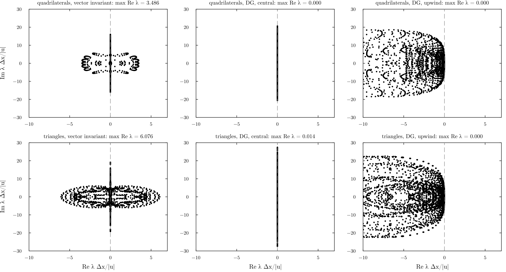
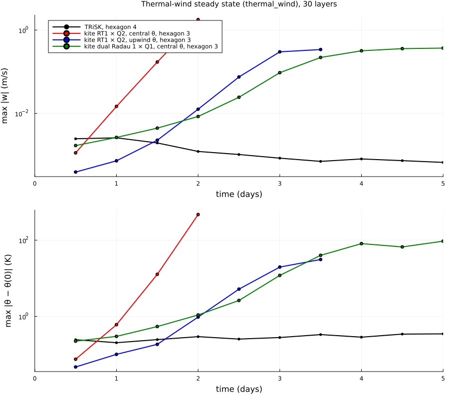
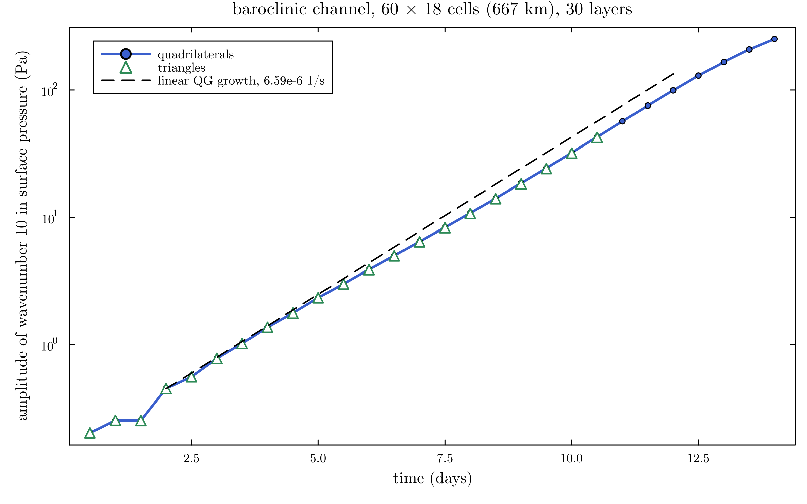
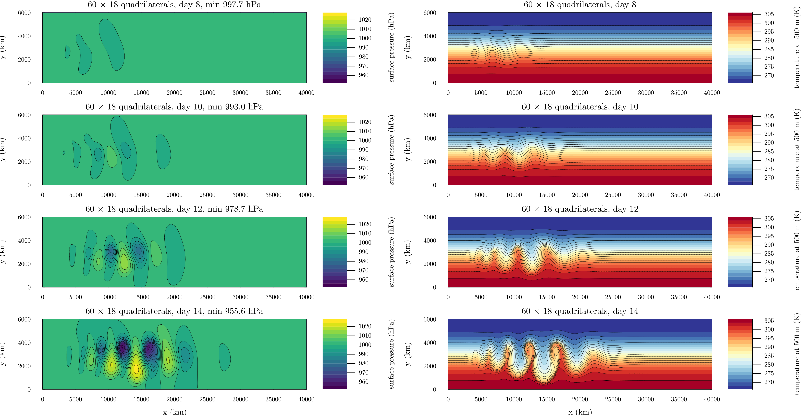
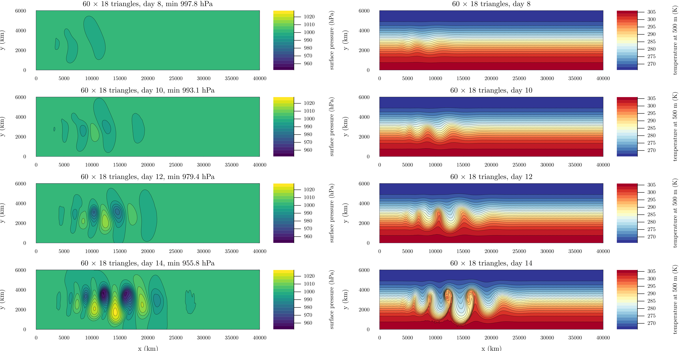
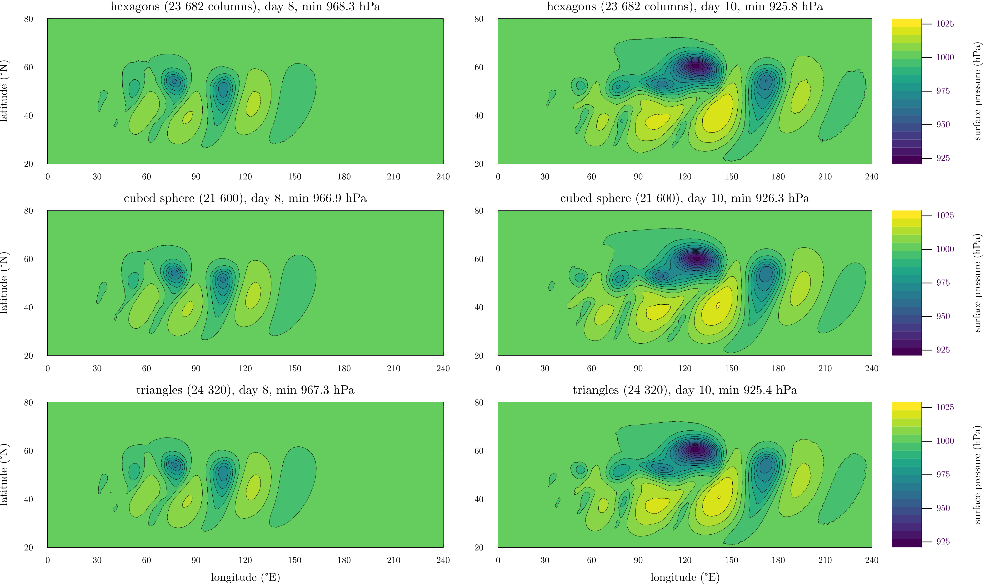
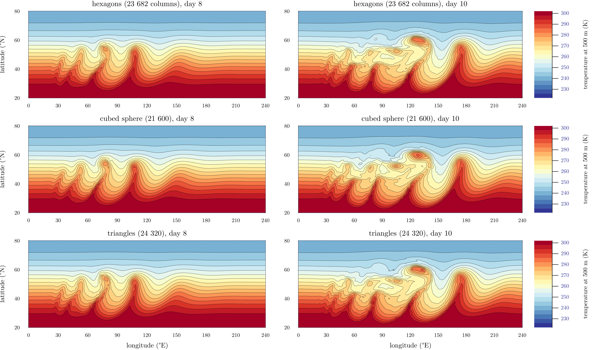
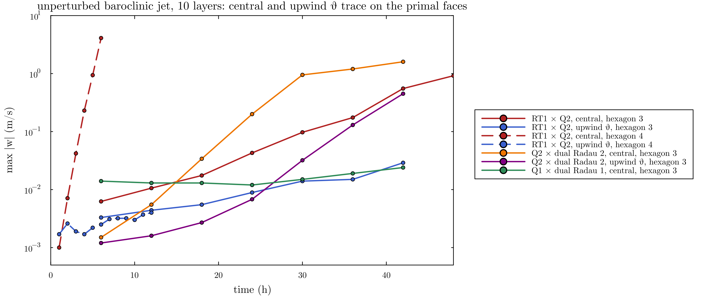

# Kite dycore: compatible finite elements (`KiteNonhydrostatic`)

Source: [src/Nonhydrostatic/Kite/](../../src/Nonhydrostatic/Kite/). Discretization:
[KITE_FEM.md](../KITE_FEM.md) (short), [KITE3D_DISCRETIZATION.md](../KITE3D_DISCRETIZATION.md)
(complete); status and the record of the tests: [KITE3D_PLAN.md](../KITE3D_PLAN.md).

## Discretization

A direct product of the 2D kite spaces of `NonlinearKiteShallowWater` with the layers: ρ and ρθ in
`KiteRadau(2)` ⊗ DG0 (37 columns per hexagon), w in `KiteRadau(2)` ⊗ CG1, u_h in `KiteBrokenRT(1)`
⊗ DG0 (or the dual Radau pair of Wess et al.). Per layer the horizontal terms are those of the
energy-conserving kite shallow-water model with ρ in place of h; the vertical terms are the Galerkin
terms of DG0 × CG1 with the trapezoidal rule (exact vertical energy exchange, upwind penalty of the
vertical ρθ flux with `vertical_theta=:upwind`), implicit in one column per Radau node
(`KiteColumn.jl`). Wicker–Skamarock RK3, HEVI.

## Status

| test | result |
|---|---|
| rest state, mass, energy exchange of the horizontal terms, adjoint vertical coupling | exact to round-off (tested) |
| steady jet, RT1 × Q2 with upwind θ on the primal faces | bounded, at the TRiSK level also on hexagon 4 |
| steady jet, central θ | node-scale θ mode, growing faster with resolution |
| perturbed baroclinic wave, hexagon 3, Q1 × dual Radau 1 | p_s 976.6 hPa at day 10 (too weak at 100 km) |
| thermal wind | **all variants grow** (upwind θ delays it by about a day) |
| thermal shallow water (one layer, TC2), DG θ (`:dg_upwind`) | θ′ bounded on hexagons, cubed sphere, triangles |
| thermal wind, DG θ, vector-invariant momentum | grows on all three meshes (supercritical vertical modes, see below) |
| thermal wind, DG θ and DG momentum advection (`horizontal_advection=:dg`) | max \|w\| ≈ 1e-4 at day 3 on hexagons, cubed sphere, triangles |
| baroclinic channel, f-plane, 60 × 18 quadrilaterals, `:dg` | k = 10 grows at 5.9–6.6e-6 1/s (linear QG 6.59e-6), min p_s 978.7 hPa at day 12 |
| baroclinic channel, 40 × 12 triangles, `:dg` | as the quadrilaterals to 1 hPa (980.7 hPa at day 12); the vector-invariant form had a grid-scale mode from day 1 |
| baroclinic wave on the sphere, RT1 × Q2, `:dg` | min p_s 925.4–926.3 hPa at day 10 on hexagon 3, cubed sphere 12, triangles 3 (TRiSK hexagon 6: 925.1) |















Earlier stage, the upwind θ trace on the steady jet:



The whole method, from shallow water to the compressible model, is written up in the paper draft
[docs/paper/kite.pdf](../paper/kite.pdf).

**Supercritical flow:** with the vector-invariant momentum and the projected continuity, the
horizontal transport is unstable once the wind is faster than the gravity waves. The eigenvalues of
the one-layer tendency in a uniform flow reach 3.5 |u|/Δx on quadrilaterals and 6 on triangles, and
in 3D the high vertical modes are always supercritical. `horizontal_advection=:dg` transports ρ,
ρθ and u (advective form, ρ-weighted mass, upwind on all kite faces) by DG with the pointwise
velocity. Then the eigenvalues are 0, and the thermal wind, the channel and the baroclinic wave
behave on all three meshes. The DG advection has a CFL limit of about 0.1 per kite and costs about 20 % per step. The model
is serial and runs on the CPU only (the DG and upwind terms are CPU loops), so there is **no GPU
timing yet**. Details: [KITE3D_PLAN.md](../KITE3D_PLAN.md).

## Run

```sh
julia --project examples/thermal_wind.jl kite 3 5 150 rt dg_upwind hexagon dg   # or cubed, triangles
julia --project examples/baroclinic_channel.jl 60 14 200 quadrilateral dg_upwind true dg   # or triangle
```
